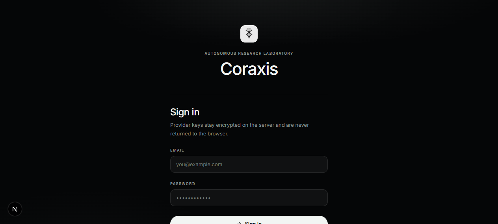
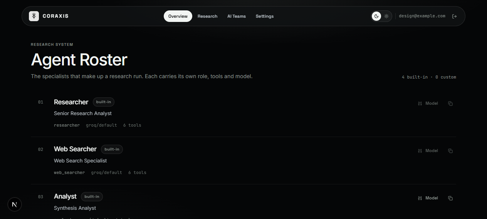
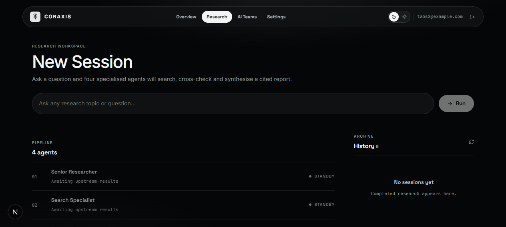
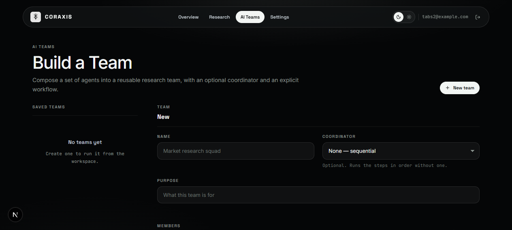
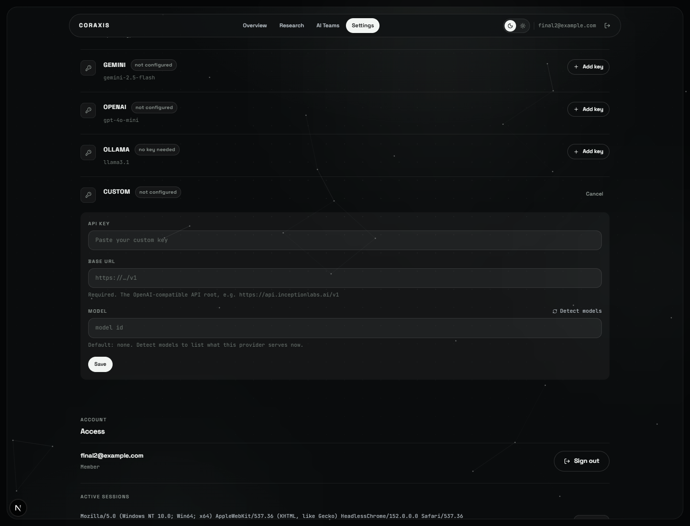

# Coraxis — Autonomous Multi-Agent Research Platform

> Give Coraxis a question. Four specialised AI agents research it live on the web — decomposing the question, searching, fetching and cross-checking sources, scoring every claim — and hand back a **cited markdown report** you can verify claim by claim. Watch the whole run stream in real time, and reconnect without losing a single event.



## The four agents

| # | Agent | What it does |
|---|-------|--------------|
| 1 | **Researcher** | Classifies the question and decomposes it into prioritised sub-questions with query variants. Recalls relevant findings from earlier runs first. |
| 2 | **Web Searcher** | Runs the searches (DuckDuckGo), fetches the best pages, and extracts clean, citation-ready text. Outbound fetches pass an SSRF guard (private/loopback/link-local hosts, non-standard ports, embedded credentials and DNS-rebinding are blocked). |
| 3 | **Analyst** | Cross-references every finding, scores sources 0–100, detects contradictions and consensus, and registers each claim with its supporting sources and a calibrated confidence. |
| 4 | **Report Writer** | Produces the final markdown report: executive summary, detailed findings with inline `[^n]` citations, a source appendix with relevance scores, and a confidence assessment. |

Citation numbers are assigned once, when a source is first seen, and never recomputed — a saved report keeps the numbering it was written with.




## Features

- **Live, resumable progress (SSE)** — every run event is persisted with a monotonic sequence number *before* it is broadcast. Reconnect with `Last-Event-ID` and you replay exactly what you missed.
- **Bring your own model** — Groq, Google Gemini, OpenAI, a local Ollama, or any OpenAI-compatible endpoint. Per-agent model settings, plus **named custom providers** (Settings → Custom Providers) that an agent can reference by nickname.
- **Keys stay secret** — provider keys are Fernet-encrypted at rest. API responses carry only a 4-character hint; no response schema has a field capable of returning a key.
- **Two ways to sign in** — Firebase Auth (GitHub OAuth / email + password) in the web app, or the built-in local accounts (`/auth/register`, `/auth/login`, rotating refresh tokens) for API-only use. Both token kinds work on every protected route.
- **Custom agents & teams** — clone or create agents, compose them into teams, and run a team instead of the default pipeline.
- **Semantic memory** — findings are embedded into a per-user ChromaDB collection so later runs can recall earlier work (can be disabled).
- **Quotas & safety rails** — per-user rate limits, a concurrent-run cap, run timeouts, and a guaranteed terminal state: a run can never hang in “running” forever.
- **Multi-user isolation** — runs, credentials, agents, teams and memory are scoped per account; cross-account reads return 404 (integration-tested).
- **Structured errors** — every failure is an RFC 7807 `application/problem+json` document with a stable `code` (catalogue: [`docs/errors.md`](docs/errors.md)).




## Architecture

```
Browser ─────────▶ Next.js (App Router)
                    typed client + SSE reader
                                    │  /api/v1 (proxied, same-origin)
                                    ▼
                              FastAPI
                              middleware → routers
                                    │
                    ┌───────────────┴───────────────┐
                    │  services/                    │
                    │  orchestration · auth · runs  │
                    └───────┬───────────┬───────────┘
                            │           │
              ┌─────────────▼─┐   ┌─────▼─────────────┐
              │ repositories/ │   │ agents/           │
              │ only DB path  │   │ framework-free    │
              └───────────────┘   │ prompts + schemas │
                                  └─────┬─────────────┘
                                        │
                            ┌───────────▼───────────┐
                            │ CrewAI + LiteLLM      │
                            └───────────────────────┘
```

Imports point one way only: `api → services → repositories → db`. The `agents/` package is pure domain code — it imports neither FastAPI nor SQLAlchemy — which is what lets the pipeline be unit-tested without an HTTP client.

## Quick start

> Deploying to production (Vercel + a backend host)? Follow [DEPLOYMENT.md](DEPLOYMENT.md) — Coraxis is two services, and a frontend-only deploy leaves sign-in and the API broken.


Requires **Python 3.11+** and **Node 18+**.

### 1. Backend

```bash
git clone https://github.com/nithincodesx/Coraxis.git
cd Coraxis

python -m venv .venv
source .venv/bin/activate        # Windows: .venv\Scripts\activate

pip install -e ".[dev]"

cp .env.example .env
# CORAXIS_SECRET_KEY is REQUIRED — generate one and put it in .env:
python -c "import secrets; print(secrets.token_urlsafe(64))"

coraxis init     # apply database migrations (SQLite by default)
coraxis serve    # API on http://127.0.0.1:8000  (docs at /docs)
```

### 2. Frontend (separate terminal)

```bash
cd frontend
npm install
cp .env.example .env.local       # fill in the NEXT_PUBLIC_FIREBASE_* values
npm run dev                      # http://localhost:3000
```

Sign in, add a provider key under **Settings**, and run your first research question from the **Research** tab.

Notes:

- **Firebase** powers the web app's sign-in (GitHub + email/password). Create a project in the Firebase console, set `CORAXIS_FIREBASE_PROJECT_ID` in `.env` and the `NEXT_PUBLIC_FIREBASE_*` values in `frontend/.env.local`. Without Firebase you can still use the full API with local accounts (below).
- **No Firebase? Use the API directly.** `POST /api/v1/auth/register` returns an access token that works on every route — no Firebase project needed.
- If your backend is not on port 8000, set `CORAXIS_BACKEND_URL` (e.g. `http://127.0.0.1:8123`) **before** `npm run build` / `npm run dev` — the frontend proxies `/api/v1` to that address.
- `coraxis dev` runs the API and frontend together; `coraxis check` prints the resolved configuration and verifies every dependency imports.

## Configuration

Every setting is a `CORAXIS_*` environment variable (see [`.env.example`](.env.example) for the full list). The ones that matter:

| Variable | Default | Notes |
|---|---|---|
| `CORAXIS_SECRET_KEY` | — | **Required.** Signs local JWTs and derives the credential-encryption key. |
| `CORAXIS_ENCRYPTION_KEY` | derived | Optional Fernet key for provider keys at rest. Set explicitly in production. |
| `CORAXIS_DATABASE_URL` | `sqlite+aiosqlite:///./coraxis.db` | PostgreSQL works unchanged: `postgresql+asyncpg://…` (install the `postgres` extra). |
| `CORAXIS_HOST` / `CORAXIS_PORT` | `127.0.0.1` / `8000` | Bind address. |
| `CORAXIS_CORS_ORIGINS` | `http://localhost:3000,http://127.0.0.1:3000` | Comma-separated allowlist. `*` is rejected in production. |
| `CORAXIS_ENV` | `development` | `development` \| `staging` \| `production`. Production refuses to boot on a weak secret, wildcard CORS, open registration, or `debug=true`. |
| `CORAXIS_ALLOW_REGISTRATION` | `true` | Set `false` after creating your accounts. |
| `CORAXIS_FIREBASE_PROJECT_ID` | — | Enables Firebase ID-token verification for the web app. |
| `GROQ_API_KEY` / `GOOGLE_API_KEY` / `OPENAI_API_KEY` | — | Optional environment fallback keys. Per-user keys saved via the API take precedence. |
| `OLLAMA_BASE_URL` | `http://localhost:11434` | Local model endpoint. |
| `CORAXIS_RATE_LIMIT_RUNS_PER_HOUR` | `20` | Per-user run rate limit. |
| `CORAXIS_RUN_TIMEOUT_SECONDS` | `900` | Max runtime per run. |
| `CORAXIS_RUN_MAX_CONCURRENT_PER_USER` | `2` | Concurrent run cap per user. |
| `CORAXIS_MAX_SOURCES` | `8` | Max sources per research query. |
| `CORAXIS_MEMORY_ENABLED` | `true` | Semantic memory via ChromaDB. |
| `CORAXIS_CHROMA_PATH` | `./chroma_db` | ChromaDB storage directory. |

## API

All routes live under `/api/v1`. Every route requires a bearer token except `/health`, `/ready`, `/version` and the local-auth endpoints (`register` / `login` / `refresh`).

| Group | Routes |
|---|---|
| System | `GET /health` · `/ready` · `/version` · `/metrics` |
| Auth | `POST /auth/register` · `/login` · `/refresh` · `/logout` · `GET /auth/me` · `/verify` · `/sessions` |
| Credentials | `GET /credentials` · `/credentials/providers` · `PUT /credentials` · `DELETE /credentials/{provider}` · `POST /credentials/test` · `/credentials/models` · `/credentials/{provider}/validate` |
| Custom providers | `GET /custom-providers` · `PUT /custom-providers` · `DELETE /custom-providers/{nickname}` · `POST /custom-providers/test` · `/custom-providers/{nickname}/validate` |
| Agents | `GET /agents` · `POST /agents` · `GET /agents/{slug}` · `PATCH /agents/{slug}` · `PUT /agents/{slug}/llm` · `DELETE /agents/{slug}` · `GET /agents/{slug}/defaults` |
| Teams | `GET /teams` · `POST /teams` · `GET /teams/{id}` · `PATCH /teams/{id}` · `DELETE /teams/{id}` |
| Runs | `POST /runs` · `GET /runs` · `GET /runs/{id}` · `GET /runs/{id}/events` · `GET /runs/{id}/stream` (SSE) · `POST /runs/{id}/cancel` · `/retry` · `DELETE /runs/{id}` · `GET /runs/{id}/report.md` |
| Memory | `GET /memory/topics` · `/memory/records` · `DELETE /memory/topics/{topic}` |

Interactive docs are served at `/docs` while the API is running.

## Development

```bash
make install     # editable install with dev extras
make migrate     # apply database migrations
make lint        # ruff check + format check
make typecheck   # mypy
make test        # pytest
make check       # lint + typecheck + test
make serve       # API with autoreload on :8000
make frontend    # Next.js dev server on :3000
make dev         # API and frontend together
```

The test suite (319 tests) splits into fast unit tests and integration tests that drive the real HTTP stack against a temporary database — auth lifecycle (both token kinds), run lifecycle and quotas, cross-account isolation, SSRF guards, and a guarantee that a stored credential is never returned by any route.

```bash
cd frontend
npm run build    # production build (also type-checks)
npx eslint .     # lint
```

## Tech stack

**Backend** — FastAPI · SQLAlchemy 2.0 (async) + Alembic · CrewAI + LiteLLM · ChromaDB + sentence-transformers · DuckDuckGo search · Trafilatura / readability-lxml · Pydantic 2 · PyJWT + Argon2id + Fernet · firebase-admin

**Frontend** — Next.js 16 (App Router) · React 19 · TypeScript 5 · Tailwind CSS 4 · Firebase client SDK

**Providers** — Groq (default), Google Gemini, OpenAI, Ollama (local), or any OpenAI-compatible endpoint

## Project layout

```
src/coraxis/
├── __main__.py           CLI entrypoint (serve · init · check · dev · create-user)
├── core/                 settings, security, crypto, logging, RFC 7807 errors, rate limiting
├── db/                   async engine, SQLAlchemy models, Alembic migrations
├── repositories/         the only code that issues database queries
├── schemas/              Pydantic request/response contracts
├── agents/               framework-free domain: prompts, task schemas, citations, tools
├── services/             orchestration · auth · runs · LLM factory · events · vector store
├── workers/              asyncio run runner
├── api/v1/               versioned routers, one module per resource
└── cli/                  serve · init · check · dev · create-user
tests/
├── unit/                 fast, framework-free unit tests
└── integration/          real DB + HTTP stack against a temporary database
frontend/                 Next.js App Router app (typed client, Firebase Auth UI)
scripts/                  evaluation / model-discovery utilities
docs/                     error catalogue + screenshots
```

## License

MIT — see [`LICENSE`](LICENSE).
